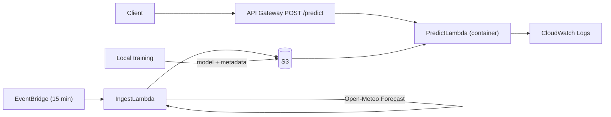

# PRD: Serverless Flight Delay Forecaster (End-to-End ML + AWS)

## 0. IDE Agent Directives
- **Environment:** macOS, Python 3.12 (project `.venv`), Docker, AWS CLI v2, AWS SAM CLI, Git.
- **Coding Style:** Simple, readable, idiomatic Python. Avoid excessive boilerplate, abstract factory patterns, or unnecessary third-party libraries.
- **Core Rule:** Prioritize strict ML hygiene (zero data leakage, time-based splits) and production-ready AWS Free Tier architecture (no paid SageMaker endpoints).
- **Workflow:** Execute one day's milestone at a time (Section 7). Verify all acceptance criteria before moving to the next day.
- **Division of Labor (learning project):**
  - **Developer writes:** all core data-science / ML code (EDA, cleaning, weather join, feature engineering, splitting, training, evaluation, inference feature logic).
  - **Agent provides:** guidance, hints, and code reviews for the above — *not* finished solutions. Agent may write setup/boilerplate (env, configs, Dockerfiles, `template.yaml`, IAM, CI) and must explain it.
- **Budget:** Hard cap of **$10 total AWS spend**. AWS Budgets alerts at $1 and $5 must exist before any deploy.

---

## 1. Project Overview & Goals
Build a deployed, event-driven machine learning system that predicts whether a commercial flight will experience a **significant arrival delay (15 minutes or more)** using schedule, route, historical, and weather data.

### Success Metrics
- **ML Performance:** Beat a Logistic Regression baseline on **PR-AUC** and **F1-score** using LightGBM with engineered temporal/weather features, measured on a chronologically held-out test set.
- **System Performance:** Sub-500ms p95 *warm* inference latency via AWS Lambda + API Gateway (cold starts reported separately).
- **Cloud Hygiene:** 100% reproducible infrastructure via AWS SAM (`template.yaml`), least-privilege IAM roles, and < $10 total AWS cost.

---

## 2. System Architecture & AWS Stack

### Data & Inference Flow
1. **Scheduled Ingestion:** `EventBridge` (cron every 15 mins) triggers `IngestLambda`.
2. **External APIs:** `IngestLambda` fetches current + next-48h hourly weather for all hub airports from the **Open-Meteo Forecast API** (no key required).
3. **Data Lake / Feature Snapshot:** `IngestLambda` writes:
   - `s3://<bucket>/raw/weather/dt=YYYY-MM-DD/HHMM.parquet` (history, expires after 30 days via lifecycle rule).
   - `s3://<bucket>/features/latest_weather.json` (the "online feature store" read by inference).
4. **Model Training (Offline/Local):** Training pipeline reads the local BTS + historical weather dataset, trains/evaluates models, and uploads `model.joblib`, `feature_metadata.json`, and `metrics.json` to `s3://<bucket>/models/<model_version>/`.
5. **Real-Time Inference:** `API Gateway` (HTTP API, `POST /predict`) routes to a **container-image AWS Lambda** (native Lambda handler, no web framework) that loads the model once per container, enriches the request with weather from `latest_weather.json` and historical priors from `feature_metadata.json`, and returns a prediction.
6. **Observability:** `CloudWatch Logs` (14-day retention) captures structured JSON logs: prediction, latency, model version, and input anomalies (unknown airport/carrier, missing weather).

### Training/Serving Consistency (No Skew)
Every feature the model uses must be computable at inference time from **(a)** the request payload, **(b)** `latest_weather.json`, or **(c)** lookup tables saved in `feature_metadata.json`. Features that fail this test may be used only in offline experiments (Section 4, Experiment B) and must not ship in the production model.



---

## 3. Data Sources & Feature Schema

### Data Sources
- **Training Data:** BTS "Reporting Carrier On-Time Performance" monthly files (3 consecutive months), filtered to flights where **both** origin and destination are in the hub list (`config/airports.csv`, 15 hubs). Expected ~200–400k rows.
- **Historical Weather:** Open-Meteo **Archive** API, hourly, for each hub, covering the training months.
- **Live Weather:** Open-Meteo **Forecast** API (same variables).
- **Stretch only:** OpenSky Network API (requires OAuth2 credentials) for a live-traffic dashboard. It provides aircraft positions only — no schedules, carriers, or delay labels — so it is **not** a model input.

### Target Variables
- `is_delayed`: Binary (`1` if `ArrDelayMinutes >= 15`, else `0`).
- `target_delay_min`: Continuous (`ArrDelayMinutes`, kept strictly as a regression target—never as a feature).
- Cancelled and diverted flights are **excluded** (no arrival delay defined). Record how many were dropped.

### Leakage Blocklist (never use as features)
`DepDelay*`, `ArrDelay*`, `ArrTime`, `DepTime`, `WheelsOff/On`, `TaxiOut/In`, `ActualElapsedTime`, `AirTime`, `*Delay` cause columns (`CarrierDelay`, `WeatherDelay`, `NASDelay`, `SecurityDelay`, `LateAircraftDelay`), `Cancelled`, `Diverted`.

### Production Features
| Group | Features | Source at inference |
|---|---|---|
| Temporal (cyclical, **local** time of origin) | `dep_hour_sin`, `dep_hour_cos`, `dow_sin`, `dow_cos`, `is_weekend`, `month` | payload (`scheduled_dep_utc` + airport tz) |
| Flight/Route | `origin_airport`, `dest_airport`, `carrier`, `scheduled_duration_min`, `distance_miles` | payload |
| Historical priors (computed on **train split only**, smoothed) | `origin_hour_delay_rate_prior`, `carrier_delay_rate_prior`, `route_delay_rate_prior` | `feature_metadata.json` |
| Weather — origin @ scheduled dep hour, dest @ scheduled arr hour | `temp_c`, `wind_speed_kmh`, `wind_gusts_kmh`, `precipitation_mm`, `snowfall_cm`, `cloud_cover_pct` (prefixed `origin_` / `dest_`) | `latest_weather.json` (payload may override) |

> Visibility was dropped: it is not available in the Open-Meteo Archive API, so it can't be trained on.

### Offline-Only Features (Experiment B)
- `origin_delay_rate_last_3h`, `carrier_delay_rate_last_24h`: computed using only flights whose **actual arrival time** is strictly before the current flight's **scheduled departure** (filtering by scheduled arrival would leak). No free live source exists for these, so they are excluded from production.

---

## 4. Machine Learning Requirements
- **Splitting Strategy:** Strict **chronological split** by scheduled departure (first 70% train, next 15% validation, final 15% test). Random `train_test_split` is prohibited. Priors and any fitted statistics use the train split only.
- **Preprocessing:** `scikit-learn` `ColumnTransformer` + `Pipeline` so transformations are bundled with the model and identical at training and inference time. Unknown categories must not crash inference (`handle_unknown="ignore"` or equivalent).
- **Models:**
  1. **Classifier Baseline:** `LogisticRegression(class_weight="balanced")` with one-hot categoricals + scaled numerics.
  2. **Classifier Primary:** `LGBMClassifier` with class imbalance handling (`scale_pos_weight` or `is_unbalance=True`). Tune on validation only.
  3. **Regressor (exact delay minutes):** `Ridge` baseline vs `LGBMRegressor` on `target_delay_min` (evaluated on MAE and RMSE on the held-out test set).
- **Decision Threshold:** Chosen on the **validation** set (maximize F1), then frozen and applied to test.
- **Experiments:**
  - **A (production):** LR vs LightGBM on production features.
  - **B (offline):** LightGBM + offline-only rolling features — quantify the value of real-time delay data you *don't* have.
- **Evaluation:** Report PR-AUC (primary), ROC-AUC, F1, Precision, Recall, and Brier Score on the held-out test set, plus the positive-class base rate (the PR-AUC of a random model). Include a calibration curve and top feature importances.
- **Artifact:** Export the full fitted pipeline via `joblib` alongside `metrics.json` and `feature_metadata.json` (feature list, threshold, priors tables, hub list, library versions, model version, training date range).

---

## 5. API & Infrastructure Specifications

### Inference Endpoint (`POST /predict`)
- **Request Payload** (weather fields optional; if omitted they are filled from `latest_weather.json`):
```json
{
  "origin_airport": "ORD",
  "dest_airport": "EWR",
  "carrier": "UA",
  "scheduled_dep_utc": "2026-11-25T18:30:00Z",
  "scheduled_duration_min": 135,
  "distance_miles": 719,
  "weather_override": {
    "origin_wind_speed_kmh": 28.5,
    "origin_precipitation_mm": 1.4
  }
}
```
- **Response `200`:**
```json
{
  "delay_probability": 0.37,
  "is_delayed": true,
  "estimated_delay_min": 14.2,
  "threshold": 0.31,
  "model_version": "2026-11-28-lgbm-v1",
  "weather_source": "forecast",
  "warnings": [],
  "latency_ms": 42
}
```
- **Errors:** `400` for invalid/missing fields or unparseable timestamp (JSON body with `error` message); `422` if origin/dest is not a supported hub or departure is outside the forecast window (> 48h ahead) with no override; `500` logged with request ID.

### Infrastructure (`template.yaml`, AWS SAM)
| Resource | Config |
|---|---|
| `ArtifactsBucket` (S3) | Block all public access, SSE-S3, lifecycle: `raw/` expires after 30 days |
| `IngestFunction` | Python 3.12 zip, 256 MB, 60s timeout, EventBridge `rate(15 minutes)` |
| `PredictFunction` | Container image (`public.ecr.aws/lambda/python:3.12` base), 1024 MB, 10s timeout, arm64 |
| `PredictApi` | API Gateway **HTTP API**, `POST /predict`, CORS enabled (for the public web UI), throttling (burst 10, rate 5 rps) |
| Log groups | 14-day retention for both functions |
| IAM | `IngestFunction`: `s3:PutObject` on `raw/*` and `features/*` only. `PredictFunction`: `s3:GetObject` on `features/*` and `models/*` only. No `*` resources. |
| Config | `MODEL_VERSION`, `BUCKET_NAME` passed as env vars |

### Cost Controls ($10 cap)
- AWS Budgets: monthly budget $5 with email alerts at $1 (actual) and $5 (forecasted).
- No NAT Gateways, no VPC, no SageMaker, no provisioned concurrency.
- Keep the predict image small (< 500 MB); delete old ECR images (lifecycle: keep last 3).
- API throttling prevents runaway invocation costs.
- Teardown command documented: `sam delete`.

---

## 6. Repository Layout
```
config/airports.csv          # hub code, name, lat, lon, IANA tz
data/{raw,interim,processed}/  # gitignored
notebooks/                   # EDA + experiments
src/fdf/                     # shared Python package (features, weather, io)
scripts/                     # CLI entry points: download, build dataset, train
lambdas/ingest/              # IngestLambda code
lambdas/predict/             # PredictLambda code + Dockerfile
models/                      # local artifacts (gitignored)
tests/                       # pytest: leakage checks, feature parity, handler
template.yaml
```

---

## 7. Daily Milestones

### Day 1 — Environment & Raw Data
- Create `.venv` (Python 3.12), install deps, project skeleton.
- Write `scripts/download_bts.py` to download 3 months of BTS data into `data/raw/`.
- **Acceptance:** `python -c "import pandas, sklearn, lightgbm"` works; raw files exist; you can state row count, column count, and date range.

### Day 2 — EDA & Target Definition
- Notebook: load, filter to hubs, drop cancelled/diverted, define `is_delayed`.
- Explore delay rate by hour, day of week, carrier, origin; class balance; missing values.
- Convert local scheduled times to UTC using airport tz (handle `2400` and overnight arrivals).
- **Acceptance:** `data/interim/flights.parquet` saved; base delay rate documented; leakage blocklist columns removed; written answers to "what surprised you?"

### Day 3 — Historical Weather Join
- `src/fdf/weather.py`: fetch Open-Meteo Archive hourly data for all hubs (cache to `data/raw/weather/`).
- Join origin weather at scheduled-dep hour and dest weather at scheduled-arr hour (UTC, floored to hour).
- **Acceptance:** join null rate < 1%; spot-check 3 flights by hand; delay rate vs. precipitation/wind plotted.

### Day 4 — Features & Chronological Split
- `src/fdf/features.py`: cyclical temporal features, split, train-only priors (with smoothing), Experiment-B rolling features.
- **Acceptance:** `tests/test_leakage.py` passes — asserts train max time < val min time < test min time, no blocklist columns, priors computed from train only, rolling features only use flights that arrived before scheduled dep.

### Day 5 — Modeling & Evaluation
- `scripts/train.py`: LR baseline and LightGBM pipelines; tune on validation; select threshold on validation; evaluate once on test.
- **Acceptance:** LightGBM beats LR on test PR-AUC and F1; `models/<version>/` contains `model.joblib`, `metrics.json`, `feature_metadata.json`; Experiment B results recorded.

### Day 6 — Inference Lambda (Local)
- `lambdas/predict/`: handler that validates input, builds the feature row with the **same** `src/fdf/features.py` code, predicts, logs.
- Dockerfile; run locally with the Lambda Runtime Interface Emulator.
- **Acceptance:** `tests/test_parity.py` — handler output equals offline pipeline prediction for 20 test-set rows; bad inputs return 400/422; image < 500 MB.

### Day 7 — Deploy to AWS & Public Demo UI
- Install AWS CLI + SAM; create IAM user/profile (no root keys); set up AWS Budgets.
- `IngestLambda` + `template.yaml`; `sam build && sam deploy --guided`; upload model artifacts.
- Build a clean static `web/index.html` (hosted free on **GitHub Pages**) where anyone can pick origin, destination, carrier, and departure time to call `POST /predict` and see `is_delayed` (1/0), `delay_probability`, and `estimated_delay_min`.
- **Acceptance:** `curl` to the live endpoint returns a prediction; `latest_weather.json` updates every 15 min; p95 warm latency < 500ms over 50 requests; CloudWatch shows structured logs; IAM policies have no wildcard resources; cost dashboard shows ~$0; GitHub Pages link works end-to-end.

### Stretch Goals
- GitHub Actions: lint + tests on push. • Model monitoring: log predictions, then join to actual BTS outcomes monthly. • OpenSky live-traffic page. • SHAP explanations in the response.

```
- **Response `200`:**
```json
{
  "delay_probability": 0.37,
  "is_delayed": true,
  "estimated_delay_min": 14.2,
  "threshold": 0.31,
  "model_version": "2026-11-28-lgbm-v1",
  "weather_source": "forecast",
  "warnings": [],
  "latency_ms": 42
}
```
- **Errors:** `400` for invalid/missing fields or unparseable timestamp (JSON body with `error` message); `422` if origin/dest is not a supported hub or departure is outside the forecast window (> 48h ahead) with no override; `500` logged with request ID.

### Infrastructure (`template.yaml`, AWS SAM)
| Resource | Config |
|---|---|
| `ArtifactsBucket` (S3) | Block all public access, SSE-S3, lifecycle: `raw/` expires after 30 days |
| `IngestFunction` | Python 3.12 zip, 256 MB, 60s timeout, EventBridge `rate(15 minutes)` |
| `PredictFunction` | Container image (`public.ecr.aws/lambda/python:3.12` base), 1024 MB, 10s timeout, arm64 |
| `PredictApi` | API Gateway **HTTP API**, `POST /predict`, CORS enabled (for the public web UI), throttling (burst 10, rate 5 rps) |
| Log groups | 14-day retention for both functions |
| IAM | `IngestFunction`: `s3:PutObject` on `raw/*` and `features/*` only. `PredictFunction`: `s3:GetObject` on `features/*` and `models/*` only. No `*` resources. |
| Config | `MODEL_VERSION`, `BUCKET_NAME` passed as env vars |

### Cost Controls ($10 cap)
- AWS Budgets: monthly budget $5 with email alerts at $1 (actual) and $5 (forecasted).
- No NAT Gateways, no VPC, no SageMaker, no provisioned concurrency.
- Keep the predict image small (< 500 MB); delete old ECR images (lifecycle: keep last 3).
- API throttling prevents runaway invocation costs.
- Teardown command documented: `sam delete`.

---

## 6. Repository Layout
```
config/airports.csv          # hub code, name, lat, lon, IANA tz
data/{raw,interim,processed}/  # gitignored
notebooks/                   # EDA + experiments
src/fdf/                     # shared Python package (features, weather, io)
scripts/                     # CLI entry points: download, build dataset, train
lambdas/ingest/              # IngestLambda code
lambdas/predict/             # PredictLambda code + Dockerfile
models/                      # local artifacts (gitignored)
tests/                       # pytest: leakage checks, feature parity, handler
template.yaml
```

---

## 7. Daily Milestones

### Day 1 — Environment & Raw Data
- Create `.venv` (Python 3.12), install deps, project skeleton.
- Write `scripts/download_bts.py` to download 3 months of BTS data into `data/raw/`.
- **Acceptance:** `python -c "import pandas, sklearn, lightgbm"` works; raw files exist; you can state row count, column count, and date range.

### Day 2 — EDA & Target Definition
- Notebook: load, filter to hubs, drop cancelled/diverted, define `is_delayed`.
- Explore delay rate by hour, day of week, carrier, origin; class balance; missing values.
- Convert local scheduled times to UTC using airport tz (handle `2400` and overnight arrivals).
- **Acceptance:** `data/interim/flights.parquet` saved; base delay rate documented; leakage blocklist columns removed; written answers to "what surprised you?"

### Day 3 — Historical Weather Join
- `src/fdf/weather.py`: fetch Open-Meteo Archive hourly data for all hubs (cache to `data/raw/weather/`).
- Join origin weather at scheduled-dep hour and dest weather at scheduled-arr hour (UTC, floored to hour).
- **Acceptance:** join null rate < 1%; spot-check 3 flights by hand; delay rate vs. precipitation/wind plotted.

### Day 4 — Features & Chronological Split
- `src/fdf/features.py`: cyclical temporal features, split, train-only priors (with smoothing), Experiment-B rolling features.
- **Acceptance:** `tests/test_leakage.py` passes — asserts train max time < val min time < test min time, no blocklist columns, priors computed from train only, rolling features only use flights that arrived before scheduled dep.

### Day 5 — Modeling & Evaluation
- `scripts/train.py`: LR baseline and LightGBM pipelines; tune on validation; select threshold on validation; evaluate once on test.
- **Acceptance:** LightGBM beats LR on test PR-AUC and F1; `models/<version>/` contains `model.joblib`, `metrics.json`, `feature_metadata.json`; Experiment B results recorded.

### Day 6 — Inference Lambda (Local)
- `lambdas/predict/`: handler that validates input, builds the feature row with the **same** `src/fdf/features.py` code, predicts, logs.
- Dockerfile; run locally with the Lambda Runtime Interface Emulator.
- **Acceptance:** `tests/test_parity.py` — handler output equals offline pipeline prediction for 20 test-set rows; bad inputs return 400/422; image < 500 MB.

### Day 7 — Deploy to AWS & Public Demo UI
- Install AWS CLI + SAM; create IAM user/profile (no root keys); set up AWS Budgets.
- `IngestLambda` + `template.yaml`; `sam build && sam deploy --guided`; upload model artifacts.
- Build a clean static `web/index.html` (hosted free on **GitHub Pages**) where anyone can pick origin, destination, carrier, and departure time to call `POST /predict` and see `is_delayed` (1/0), `delay_probability`, and `estimated_delay_min`.
- **Acceptance:** `curl` to the live endpoint returns a prediction; `latest_weather.json` updates every 15 min; p95 warm latency < 500ms over 50 requests; CloudWatch shows structured logs; IAM policies have no wildcard resources; cost dashboard shows ~$0; GitHub Pages link works end-to-end.

### Stretch Goals
- GitHub Actions: lint + tests on push. • Model monitoring: log predictions, then join to actual BTS outcomes monthly. • OpenSky live-traffic page. • SHAP explanations in the response.